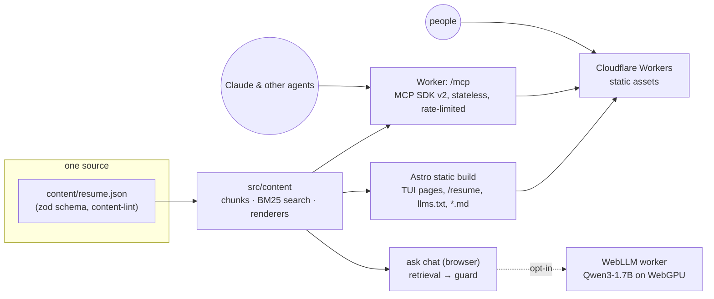

# geraltheart.com

A terminal-style portfolio with three front doors: a keyboard-first TUI website for people, a public
read-only **MCP server** for agents, and an **"ask" chat that runs a small LLM entirely in your
browser**. All three read one content file, so updating `content/resume.json` updates everything.

- **Site:** <https://geraltheart.com>. Works without JavaScript; with it, it becomes a terminal
  session (type commands, press `1`–`9`, or click).
- **MCP:** `https://geraltheart.com/mcp` (Streamable HTTP, no auth, read-only).
- **llms.txt:** <https://geraltheart.com/llms.txt>, plus a markdown version of every page.

## Architecture



| Piece          | Where                                       | Notes                                                                                                                                                                        |
| -------------- | ------------------------------------------- | ---------------------------------------------------------------------------------------------------------------------------------------------------------------------------- |
| Content        | `content/resume.json`, `src/content/`       | One schema (`schema.ts`); chunks with stable ids for citations; dependency-free BM25 (`search.ts`) shared by the MCP server, the chat, and its fallback                      |
| Site           | `src/pages`, `src/components`, `src/styles` | Astro, static output, no framework runtime. Every command is a real page, so links work without JS                                                                           |
| Shell          | `src/shell`                                 | Progressive enhancement: a command fetches its page and appends that page's `[data-cmd]` section to the scrollback, so there is one renderer for JS and no-JS                |
| Glyph dissolve | `src/fx/glyph-dissolve.ts`                  | Canvas overlay that assembles text from slivers of its own glyphs; the real text stays in the DOM; off for reduced motion                                                    |
| MCP server     | `src/worker`                                | `tools.ts` holds plain tool definitions; `server.ts` is the only file that touches the SDK; guards: host/origin allowlists, Workers Rate Limiting (60/min/IP), 16 KiB bodies |
| Ask chat       | `src/chat`                                  | Keyword search everywhere; opt-in Qwen3-1.7B via WebLLM in a Web Worker; a grounding guard decides what may be shown                                                         |
| sim            | `src/sim`                                   | ASCII port of [LiDAR Scout](https://github.com/GHeart01/LiDAR-Scout): shared LiDAR map, A* pursuit, 44×44 grid in half blocks                                                |

`/mcp` is two things at once: browsers get the page explaining how to connect, and MCP clients
(POST, or GET asking for an event stream) get the server.

## Connect an agent

```sh
claude mcp add --transport http geraltheart https://geraltheart.com/mcp
```

In claude.ai or Claude Desktop, open **Customize → Connectors → + → Add custom connector** and paste
the URL. For stdio-only clients:

```json
{
  "mcpServers": {
    "geraltheart": { "command": "npx", "args": ["-y", "mcp-remote", "https://geraltheart.com/mcp"] }
  }
}
```

Tools: `get_profile`, `get_experience`, `list_projects`, `get_project(name)`, `get_skills`,
`search(query)`, `get_resume`. All are read-only and return markdown plus structured data.

## How the chat stays honest

The model is small, so the guard does the heavy lifting (`src/chat/guard.ts`):

1. Greetings, contact, and resume requests get fixed answers, with no model call.
2. Retrieval runs first. If nothing in the question exists in the content, the chat refuses before
   the model runs.
3. The prompt demands `[section-id]` citations or the exact reply `NOT_IN_CONTENT`.
4. Afterwards, a sentence is shown only if its checkable facts (names, numbers, URLs, emails) appear in
   a retrieved section. Missing or wrong citations are repaired by attributing the sentence to the
   section that supports it; unsupported sentences are dropped.

`pnpm eval:chat` runs 28 questions (15 answerable, 13 traps) against the real model in headed Chrome.
Latest run: **27/28 pass, 0 invented facts, refusal precision 1.0**, about 1 s median per answer. Real bad
outputs from those runs are unit-test fixtures in `tests/chat.test.ts`.

## Develop

Requires Node ≥ 22.12 and pnpm 11.

```sh
pnpm install
pnpm dev            # Astro dev server on :5190 (proxies /mcp to :8787)
pnpm dev:worker     # the real Worker + assets runtime on :8787 (rebuilds on change)
```

| Script                | What it does                                                                               |
| --------------------- | ------------------------------------------------------------------------------------------ |
| `pnpm check`          | `astro check` plus type checks for the Worker and the runtime-agnostic content modules     |
| `pnpm lint`           | ESLint and Prettier                                                                        |
| `pnpm test`           | Vitest: content, search, MCP (v1 and v2 clients against the Worker), chat guard, sim       |
| `pnpm test:e2e`       | Playwright against `wrangler dev`: no-JS plain path, shell, axe, MCP in workerd, chat, sim |
| `pnpm lhci`           | Lighthouse CI (performance ≥ 0.9, accessibility = 1.0)                                     |
| `pnpm eval:chat`      | Local only: the in-browser model eval (needs WebGPU; downloads ~1 GB once into `.cache/`)  |
| `pnpm content:lint`   | Content-safety scan (also runs as a pre-commit hook and in CI)                             |
| `pnpm content:schema` | Regenerate `content/resume.schema.json` after schema changes                               |
| `pnpm deploy:dry`     | Bundle the Worker without deploying                                                        |

## Editing content

Edit `content/resume.json`; the `$schema` line gives editor autocomplete. Everything else (pages,
MCP tools, llms.txt, chat) picks the change up on the next build. The build fails if the content
doesn't match the schema or trips a safety rule.

**Content safety.** The day job is in an ITAR-regulated environment, so work is described at the
architecture level only. `pnpm content:lint` blocks phone numbers, unlisted emails, model/part-number
shaped tokens, and controlled-data phrasing, and warns on headcounts and percentages. A private
denylist of internal names lives in the gitignored `.content-denylist` (and the `CONTENT_DENYLIST`
Actions secret); hits are reported by line and entry number only, never by the text.

## Deploy

The Worker is named `geraltheart-v2` on purpose, so a deploy can never overwrite an existing
Worker.

```sh
pnpm exec wrangler deploy
```

Then attach the custom domain in the Cloudflare dashboard, add a `www` redirect, and optionally add
a WAF rate-limit rule on `/mcp` as an outer layer.

Designed in, not built yet:

- `curl geraltheart.com` returning a plain-text resume: add `/` to `run_worker_first` and branch on the user agent.
- `ssh geraltheart.com`: a Go server using Wish, reading the same `content/resume.json` and its JSON Schema.

## License

Code: MIT (see `LICENSE`). The content (`content/`, `public/og.png`) is © Geralt Heart. JetBrains
Mono is under the SIL Open Font License (`public/fonts/OFL.txt`).
